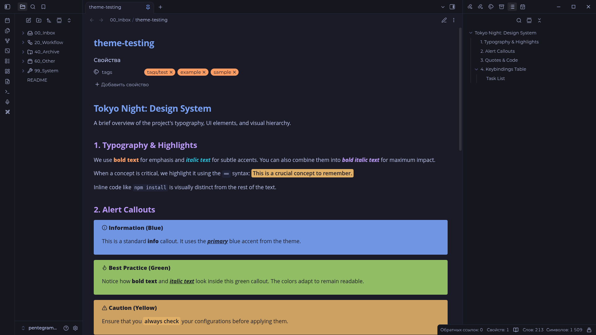
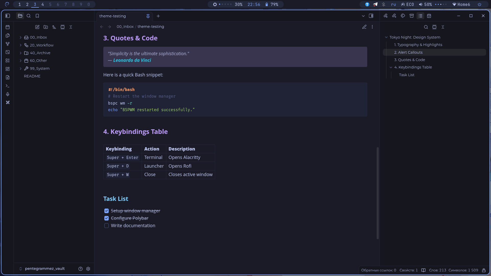

# tokyo-night-by-machineslego-wq Theme for Obsidian

**English** | [Русский](./README.ru.md)

A strict, flat and vibrant theme for Obsidian, inspired by the **Tokyo Night** color palette.

This theme is the logical extension of my desktop environment setup. If you want your notes to look as strict as your terminal, window manager and panel — this theme is for you.




## ✨ Features

- **Flat design:** No distracting shadows or unnecessary rounding. Strict, clean and minimal.
- **Vibrant accents:** Highly readable highlight (`==`), expressive typography for bold, italic and bold-italic.
- **Smart Callouts:** Fully styled and adapted for both desktop and mobile. Custom tags supported.
- **Edit = Read:** Live Preview mode is tuned to look almost indistinguishable from Reading mode.
- **Two modes:** Full support for both dark and light (Day) Obsidian themes.
- **Style Settings support:** Every color in the theme can be changed via GUI — no CSS editing needed. Separate pickers for dark and light modes.

## 📦 Installation

### Method 1: Manual installation (Linux and Windows)

The most reliable method if you want to install the theme directly from the sources.

**Linux:**
1. Download `theme.css` and `manifest.json` from this repository.
2. Open a terminal and go to your Obsidian vault's themes folder:
   ```bash
   cd /path/to/your/vault/.obsidian/themes/
   ```
   *If the `themes` folder doesn't exist, create it: `mkdir -p .obsidian/themes/`*
3. Create a folder for the theme (e.g. `tokyo-night-by-machineslego-wq`) and copy the files into it:
   ```bash
   mkdir "tokyo-night-by-machineslego-wq"
   cp ~/Downloads/theme.css ~/Downloads/manifest.json "tokyo-night-by-machineslego-wq/"
   ```
4. Restart Obsidian, go to **Settings → Appearance → Themes** and select **tokyo-night-by-machineslego-wq**.

**Windows:**
1. Download `theme.css` and `manifest.json`.
2. Open Explorer and navigate to your vault folder.
3. Open the `.obsidian` folder, then `themes`. (If the `themes` folder doesn't exist, create it).
4. Create a new folder named `tokyo-night-by-machineslego-wq` and place both files inside.
5. Restart Obsidian, go to **Settings → Appearance → Themes** and select **tokyo-night-by-machineslego-wq**.

### Method 2: Via BRAT (Auto-update from GitHub)

[BRAT](https://github.com/TfTHacker/obsidian42-brat) (Beta Reviewers Auto-update Tester) is a plugin that lets you install and auto-update themes directly from a GitHub repository.

1. Install and enable the **BRAT** plugin under **Settings → Community plugins**.
2. Open **Settings → BRAT → Beta Themes List**.
3. Click **Add Beta Theme** and enter the repository URL:
   ```
   https://github.com/machineslego-wq/tokyo-night-by-machineslego-wq
   ```
4. The theme will be installed. Go to **Settings → Appearance → Themes** and select **tokyo-night-by-machineslego-wq**.

### Method 3: From GitHub Releases (ZIP)

If you prefer to download a ready-made archive:

1. Go to the [Releases](https://github.com/machineslego-wq/tokyo-night-by-machineslego-wq/releases) page.
2. Download the latest `.zip` file (e.g. `tokyo-night-by-machineslego-wq-X.X.X.zip` — see the latest release for the exact name).
3. Extract the archive into your vault's `.obsidian/themes/` folder.
   *Make sure the final path looks like: `<vault>/.obsidian/themes/tokyo-night-by-machineslego-wq/`*
4. Restart Obsidian, go to **Settings → Appearance → Themes** and select **tokyo-night-by-machineslego-wq**.

## 🎨 Customization

### Via Style Settings (Recommended)

The theme ships with full **Style Settings** support. Every color can be changed through a GUI — no CSS editing required.

1. Install and enable the **[Style Settings](https://github.com/mgmeyers/obsidian-style-settings)** plugin under **Settings → Community plugins**.
2. Open **Settings → Style Settings → Tokyo Night Theme**.
3. Adjust any color — **separate pickers for dark and light themes**.

Available settings:

- **Backgrounds** — primary, alternate, secondary, borders
- **Text** — normal, muted, faint, on-accent
- **Accents** — accent color, accent hover (also drives caret + interactive elements)
- **Headings** — H1 through H6
- **Inline formatting** — bold, italic, bold+italic
- **Highlights** — background and text color of `==highlighted==` text
- **Blockquotes** — accent color for border and translucent tint
- **Code blocks** — 12 colors (comment, function, keyword, operator, property, punctuation, string, tag, value, important, normal, background)
- **Tags** — background and text color of `#tags`
- **Callouts** — 5 semantic colors (blue / green / yellow / red / purple)
- **PDF tags** — background and text color of PDF file labels

Changes are applied immediately. All default values match the original Tokyo Night palette.

### Manual CSS

If you don't want to use Style Settings, you can still edit `theme.css` directly — the file uses CSS variables at the top (`body.theme-dark` / `body.theme-light`), so any override is a one-line change.

## 🔄 Updating

- **Manual installation:** Download the latest `theme.css` and `manifest.json` from the repository and replace the existing files in `.obsidian/themes/tokyo-night-by-machineslego-wq/`. Restart Obsidian or use the command palette (`Ctrl+P`) → **Reload app without saving**.
- **BRAT:** BRAT checks for updates automatically. You can also trigger a manual check in **Settings → BRAT**.
- **GitHub Releases:** Download the new `.zip` from the releases page and extract it over the existing folder, replacing the old files.

## 🔗 Related projects

The theme is designed to perfectly complement my minimalist BSPWM desktop setup.
Check out the configs here: **[BSPWM-machineslego](https://github.com/machineslego-wq/BSPWM-machineslego)**

## 📄 License

MIT