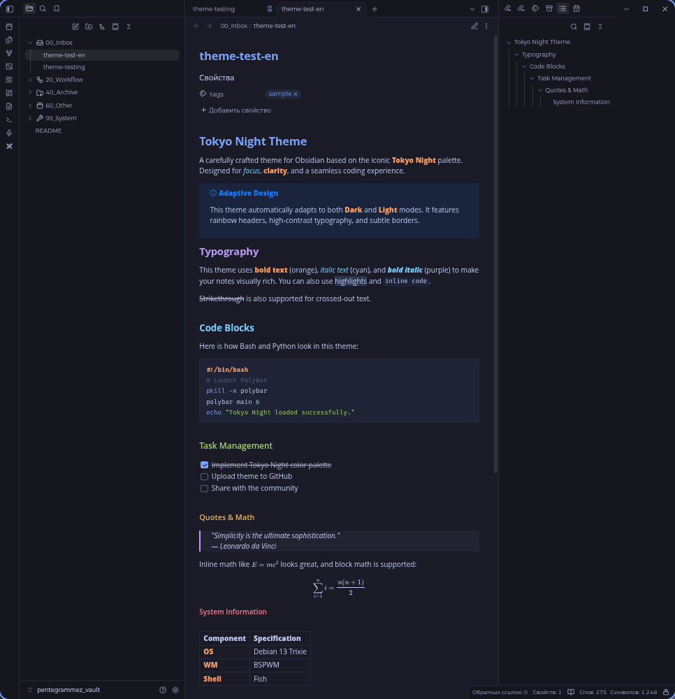

# Tokyo Night by machineslego-wq

Полноценная тема для Obsidian, основанная на культовой палитре **Tokyo Night**. Тема адаптирована для комфортной работы как в темное, так и в светлое время суток, и добавляет яркие контрастные акценты в Markdown-разметку.

## ✨ Особенности

- **Две темы в одной:** Плавное и правильное переключение между Dark (Tokyo Night) и Light (Tokyo Night Day) режимами. Тема автоматически подстраивается под настройки вашей ОС или Obsidian.
- **Радужные заголовки:** Заголовки от H1 до H6 окрашены в разные цвета палитры Tokyo Night (синий, фиолетовый, голубой, зеленый, желтый, красный) для лучшей визуальной навигации по заметкам.
- **Контрастный текст:** 
  - **Жирный** текст выделен оранжевым.
  - *Курсив* — нежно-голубым.
  - ***Жирный курсив*** — фиолетовым.
- **Стильные блоки кода:** Блоки кода получили аккуратную рамку, скругленные углы и собственные цвета синтаксиса (вдохновленные терминалами Linux). Встроенный код (inline code) мягко подсвечивается на фоне.
- **Аккуратные цитаты:** Блоки цитат (`>`) и Callout-блоки получили стильную рамку и полупрозрачный фон.
- **Ссылки и акценты:** Все интерактивные элементы (ссылки, чекбоксы, каретки) используют мягкий синий/голубой цвет.
- **Минимализм:** Убраны лишние визуальные шумы и навязчивые тени. Оформление меню, вкладок и PDF-файлов приведено к единому строгому виду.

## 📥 Установка

### Способ 1: Как CSS-сниппет (Рекомендуемый)
1. Скачайте файл `theme.css` из этого репозитория.
2. Положите его в папку вашего хранилища: `.obsidian/snippets/`.
3. В Obsidian откройте `Настройки -> Внешний вид -> CSS-сниппеты`.
4. Нажмите кнопку обновления (иконка круговой стрелки) и включите переключатель напротив файла.

### Способ 2: Как полноценная тема
1. Скачайте папку с репозиторием (или сделайте `git clone`).
2. Переместите её в директорию `.obsidian/themes/` вашего хранилища.
3. В настройках Obsidian (`Настройки -> Внешний вид -> Темы`) выберите тему в списке.

## 🎨 Как работает переключение тем

Тема использует классы `.theme-dark` и `.theme-light`, которые Obsidian применяет автоматически. Вам не нужно ничего настраивать вручную — просто переключите тему в настройках Obsidian (или в вашей ОС), и цвета мгновенно адаптируются.

## 🛠 Кастомизация

Если вы хотите изменить цвета под себя, откройте файл `theme.css`. В самом верху вы найдете блоки `body.theme-dark` и `body.theme-light`. Вы можете менять HEX-коды основных переменных, например:
- `--text-accent`: цвет ссылок и кнопок.
- `--h1-color` ... `--h6-color`: цвета заголовков.
- `--bold-color`: цвет жирного текста.

## 📄 Лицензия

Этот проект распространяется под лицензией MIT. Вы можете свободно изменять, дополнять и распространять тему.